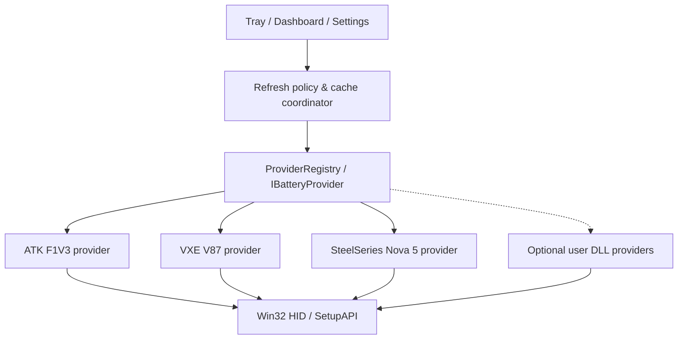

# Peripheral Battery Lite

[简体中文](README.md) · [Releases](https://github.com/BakerSean168/peripheral-battery-lite/releases) · [Provider guide](docs/PLUGINS.md) · [MIT License](LICENSE)

**A small, extensible Windows tray monitor for wireless peripheral batteries.** Read mouse, keyboard and headset battery levels directly over HID, without leaving vendor control software running.

> Early-stage project: the three models below were verified with real hardware on one Windows 11 PC. Other firmware versions and receivers have not necessarily been tested.

## Verified peripherals

| Device | Connection | Receiver VID:PID | Protocol |
| --- | --- | --- | --- |
| ATK F1V3 mouse | Proprietary 2.4 GHz dongle | `373B:1303` | Nordic/Compx, 17-byte HID |
| VXE V87 keyboard | Proprietary 2.4 GHz dongle | `320F:5088` | Vendor battery/status query, 64-byte HID |
| SteelSeries Arctis Nova 5 | Proprietary 2.4 GHz dongle | `1038:2232` | SteelSeries battery query, 65-byte HID |

**Verification:** These exact models returned battery readings during physical Windows tests. Detecting a USB VID/PID alone is not considered proof of compatibility.

## Features

- **Native WinForms tray and floating dashboard:** battery percentages, bars and last successful query timestamps.
- **Manual refresh by default:** startup and cache display do not query HID; in manual mode the application does not register for Raw Input mouse/keyboard events.
- **Optional auto refresh:** off, every 30 minutes, 1 hour, 2 hours or 5 hours.
- **Optional activity-only refresh:** passive Windows Raw Input device headers identify recent use of supported mice and keyboards, without logging typed characters. There is no reliable passive headset awake signal: audio providers remain manual-only when activity-only is on.
- **Concurrent per-device query processes:** up to three isolated HID readers run in parallel, with each completed device card updated immediately. A stalled device does not block the others.
- **Local cache:** preserve the last successful battery value and its timestamp, alongside the most recent failure time. Unchanged percentages reuse the existing tray icon.
- **Opt-in Windows login startup** using the current user's Run key.
- **Extensible protocol providers:** three built-in `IBatteryProvider` implementations, plus optional compiled .NET Framework DLL providers. Third-party DLLs are disabled by default and **are not sandboxed**.

Stack: C#, WinForms, .NET Framework 4.x, Windows HID/SetupAPI, JSON. No Electron, browser engine, cloud account or network telemetry.

## Installation

Download the complete Windows x64 portable package from [Releases](https://github.com/BakerSean168/peripheral-battery-lite/releases). Extract **all files** to a writable folder, such as:

```text
D:\opt\PeripheralBatteryLite\
├── PeripheralBatteryLite.exe
├── PeripheralBatteryLite.Probe.exe
├── PeripheralBatteryLite.Contracts.dll
├── portable.flag
├── battery-cache.json       # created after a successful refresh, or migrated
├── settings.json            # created after changing settings, or migrated
└── Plugins\                 # optional, trusted extensions only
```

Launch `PeripheralBatteryLite.exe`, left-click its system tray icon to open the panel, and select **Refresh**. Open settings from the panel or tray context menu.

If `portable.flag` is present, settings and cache are stored **next to the program**. Without the marker, legacy settings and cache are stored under `%LOCALAPPDATA%\PeripheralBatteryLite`. See [portable migration guide](docs/PORTABLE.md).

If you move the folder after enabling Windows startup, update the Run registry path or toggle the startup preference again.

## Sleep and polling safety

| Option | What happens |
| --- | --- |
| Off (default) | No automatic HID battery queries; only cached values are displayed |
| 30 / 60 / 120 / 300 minutes | Eligible devices are queried only when the interval has elapsed |
| Activity-only (on by default) | Mouse/keyboard require a matching device input event in the past ~3 minutes |
| Audio with activity-only | Nova 5 is skipped by automatic polling; manual refresh remains available |
| Activity-only disabled | All devices may be queried on schedule, possibly waking them |

Recent input activity is a best-effort signal, **not a direct device power-state API**. Even a read-only battery request may delay device sleep.

## Build and tests

Run from Windows PowerShell with the .NET Framework C# compiler available:

```powershell
.\build.ps1
.\dist\PeripheralBatteryLite.Probe.exe --self-test
.\dist\PeripheralBatteryLite.Probe.exe --storage-paths
.\dist\PeripheralBatteryLite.Probe.exe --cache-show
.\dist\PeripheralBatteryLite.Probe.exe --once
```

`--once` queries actual hardware. The other commands above do not. CI builds on Windows and checks parsers, the provider ABI, refresh policy and persistence; it **does not perform physical hardware testing**.

## Provider architecture



Implementations live in `Providers/`, `Core/`, `Contracts/`, `Platform/` and `UI/`. Plugins reference `PeripheralBatteryLite.Contracts.dll`. DLLs execute in process with the current user's permissions—**only enable extensions you trust**.

See [Plugin development](docs/PLUGINS.md), [architecture](docs/ARCHITECTURE.md) and [contributing](CONTRIBUTING.md).

## Existing alternatives and protocol research

This is an independent Windows application implementation, informed by publicly described HID message formats and real device observations. If a broader ecosystem of hardware support is the goal, [JKWTCN/BatteryMonitor](https://github.com/JKWTCN/BatteryMonitor) already offers a **sandboxed QuickJS HID plugin host**.

See [open-source landscape](docs/ECOSYSTEM.md) and [protocol provenance / upstream licenses](docs/PROTOCOL_SOURCES.md).

**Disclaimer:** Not affiliated with device manufacturers. Unverified hardware and firmware may behave differently.

## License

Original code and documentation in this repository are licensed under the [MIT License](LICENSE). Referenced protocol research projects retain their own licenses; this project's license does not relicense third-party code.
