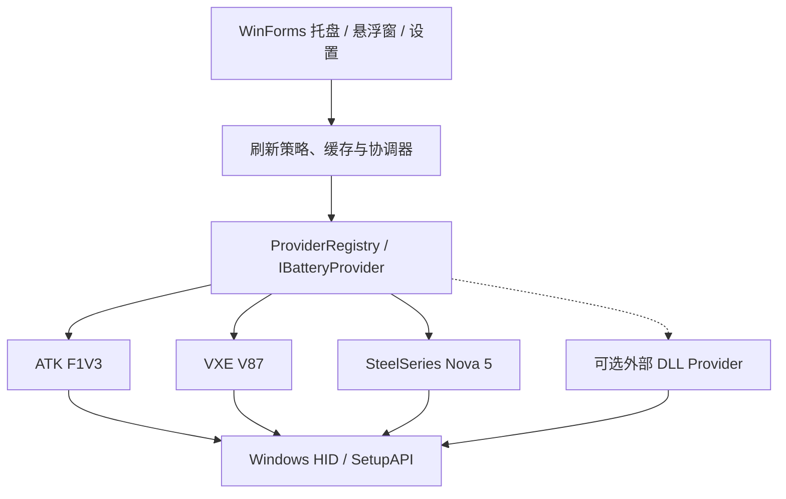

# Peripheral Battery Lite

[English](README.en.md) · [Releases](https://github.com/BakerSean168/peripheral-battery-lite/releases) · [插件开发](docs/PLUGINS.md) · [MIT License](LICENSE)

**轻量、可扩展的 Windows 外设电量托盘。** 统一查看无线鼠标、键盘和耳机的电量；直接通过 HID 查询设备，不要求厂商管理软件常驻。

> 状态：早期版本，已在一台 Windows 11 实机上验证三台设备。其他固件版本和接收器不保证兼容。项目目前仍为 GitHub **私有仓库**；添加许可证不等于将仓库公开。

## 已验证设备

| 设备 | 连接方式 | 接收器 VID:PID | 电量协议 |
| --- | --- | --- | --- |
| ATK F1V3 | 2.4G 接收器 | `373B:1303` | Nordic/Compx，17 字节 HID 报文 |
| VXE V87 | 2.4G 接收器 | `320F:5088` | 厂商状态查询，64 字节 HID 报文 |
| SteelSeries Arctis Nova 5 | 2.4G 接收器 | `1038:2232` | SteelSeries，65 字节 HID 报文 |

**验证口径：** 上表为本项目实机成功读取到电量的设备，不代表相同品牌的其他型号已经适配。仅检测到 VID/PID、能枚举 HID 接口，不算电量读取成功。

## 功能

- **Windows 原生托盘 + 悬浮面板**：查看设备电量、上次查询时间及缓存状态。
- **默认纯手动刷新**：启动、打开面板、悬停图标时不主动查询 HID；手动模式也不注册键鼠 Raw Input 监听，避免不必要的后台输入处理。
- **可选自动查询**：关闭、每 30 分钟、1 小时、2 小时或 5 小时。
- **设备活动限制**：通过 Windows Raw Input 的设备来源信息判断鼠标/键盘近期是否使用过；不会记录按键文本。耳机没有可靠的被动活动信号，启用活动限制时只支持手动刷新。
- **并行刷新与异常隔离**：最多三台设备通过独立诊断进程并行查询，各设备完成后立即更新对应卡片。每台独立超时，慢设备不会卡住其他设备。
- **本地缓存**：查询失败保留最后一次成功结果与时间，同时显示最近失败的时间；不会把历史电量误标成实时值。托盘电量未变时不重新生成图标。
- **可选开机自启动**：使用当前用户注册表项，不需要管理员权限。
- **协议插件**：内置三个 `IBatteryProvider`；可编译自己的 .NET Framework DLL，无须重新构建主程序。第三方 DLL 默认禁用，**不提供沙箱**。

**技术栈：** C#、WinForms、.NET Framework 4.x、Windows HID/SetupAPI、JSON。本项目无 Electron、浏览器内核、云端账户或网络遥测。

## 下载与运行

从 [Releases](https://github.com/BakerSean168/peripheral-battery-lite/releases) 下载 Windows x64 便携包，**完整解压**到一个有写入权限的目录，例如：

```text
D:\opt\PeripheralBatteryLite\
├── PeripheralBatteryLite.exe
├── PeripheralBatteryLite.Probe.exe
├── PeripheralBatteryLite.Contracts.dll
├── portable.flag
├── settings.json                  # 第一次保存设置后创建，或从旧版迁入
├── battery-cache.json             # 第一次成功手动刷新后创建，或从旧版迁入
├── Plugins\                       # 可选，仅放可信插件
└── docs\
```

双击 `PeripheralBatteryLite.exe`，然后点击系统托盘图标打开悬浮面板，按 **刷新电量** 查询。右键托盘图标还可以打开设置、切换开机启动、退出。

`portable.flag` 让缓存与设置**和程序放在同一个目录**。如果没有标记文件，则兼容旧版的 `%LOCALAPPDATA%\PeripheralBatteryLite`。更多说明见 [便携迁移指南](docs/PORTABLE.md)。

> 切换安装位置时，请保留整套 EXE/DLL，并同步复制 `settings.json` 与 `battery-cache.json`。在启用开机自启动后移动目录，还需更新 Windows Run 注册表里的 EXE 路径。

## 自动查询与休眠

| 设置 | 行为 |
| --- | --- |
| 关闭（默认） | **完全不自动查询**，只显示缓存；点击刷新才发送 HID 命令 |
| 30 分钟 / 1 / 2 / 5 小时 | 到期时判断设备是否符合自动查询条件 |
| 仅查询近期活动设备（默认开启） | 鼠标、键盘需要在最近约 3 分钟内产生对应 Raw Input 事件 |
| 活动限制 + Nova 5 | 无法可靠被动判断耳机是否醒着，所以跳过自动查询 |
| 关闭活动限制 | 到期时允许尝试所有设备，**可能影响设备休眠** |

活动状态是软件启发式判断，**不是厂商提供的设备睡眠状态 API**。即使只是读取电量，也可能唤醒或延迟设备休眠。

## 架构与插件



外部插件由 `Plugins/` 目录加载。插件使用编译后的 C# DLL，需引用 `PeripheralBatteryLite.Contracts.dll`。**插件与主程序具有相同系统权限**，不要加载来源不明的 DLL。

完整接口与最小示例：[插件开发指南](docs/PLUGINS.md)、[示例](tests/SamplePlugin.cs)；架构和扩展策略详见 [设计说明](docs/ARCHITECTURE.md)。

## 开发与测试

Windows 10/11 x64，需 Windows .NET Framework 4.x 的 C# 编译器（`csc.exe`）。在 Windows PowerShell 中：

```powershell
.\build.ps1
.\dist\PeripheralBatteryLite.Probe.exe --self-test
.\dist\PeripheralBatteryLite.Probe.exe --storage-paths
.\dist\PeripheralBatteryLite.Probe.exe --cache-show
.\dist\PeripheralBatteryLite.Probe.exe --once
```

`--once` **会实际查询外设**，而 `--self-test`、`--storage-paths`、`--cache-show` 不会。CI 在 Windows runner 上执行编译、协议解析、插件 ABI、设置和缓存测试；**CI 不具备实机外设，不能替代 HID 硬件验收**。

贡献说明：[CONTRIBUTING.md](CONTRIBUTING.md)。

## 现有项目与协议来源

该程序的 GUI、存储与 HID 调度代码为独立 C# 实现；协议格式、接收器 ID 和测试方法参考已有开源资料。尤其值得关注的是 [JKWTCN/BatteryMonitor](https://github.com/JKWTCN/BatteryMonitor)，它已经有 **QuickJS 沙箱化 HID 插件体系**，更适合广泛支持各种外设。详见：

- [协议来源与第三方许可证](docs/PROTOCOL_SOURCES.md)
- [为什么自建，以及和现有开源项目的比较](docs/ECOSYSTEM.md)

**免责声明：** 这不是设备厂商的官方软件；未经验证的固件/接收器可能无法查询或返回不同格式。请勿把本项目的实验性 HID 读操作用于固件升级、配对或设备配置。

## 许可证

本项目作者自有的代码和文档按 **[MIT License](LICENSE)** 授权。外部参考项目各自的许可证保持有效；在此列出协议资料来源不意味着将对方源代码重新授权为 MIT。商标属于各自权利人。请参阅 [来源清单](docs/PROTOCOL_SOURCES.md)。
